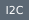

<p align="center">
  
</p>

- 🛠️ **10 years of building:** from enterprise software to embedded systems to AI on vehicles
- 🔭 **Now:** TinyML on microcontrollers, a home sensor agent, PhD on model reliability
- 🌱 **Learning:** TensorRT, event streaming, LLM agents

## Tech stack

<table>
  <tr>
    <td align="center" width="22%"><b>Perception</b></td>
    <td>
      
      
      
      
      
      
      
      
      
    </td>
  </tr>
  <tr>
    <td align="center" width="22%"><b>Uncertainty &amp; reliability</b></td>
    <td>
      
      
      
      
      
    </td>
  </tr>
  <tr>
    <td align="center" width="22%"><b>Observers &amp; fusion</b></td>
    <td>
      
      
      
      
      
    </td>
  </tr>
  <tr>
    <td align="center" width="22%"><b>Control</b></td>
    <td>
      
      
      
      
      
    </td>
  </tr>
  <tr>
    <td align="center" width="22%"><b>Edge AI</b></td>
    <td>
      
      
      
      
      
    </td>
  </tr>
  <tr>
    <td align="center" width="22%"><b>Real-time &amp; OS</b></td>
    <td>
      
      
      
      
      
      
      
      
    </td>
  </tr>
  <tr>
    <td align="center" width="22%"><b>Virtualization &amp; MLOps</b></td>
    <td>
      
      
      
      
      
      
      
      
    </td>
  </tr>
  <tr>
    <td align="center" width="22%"><b>Distributed communication</b></td>
    <td>
      
      
      
      
      
      
    </td>
  </tr>
  <tr>
    <td align="center" width="22%"><b>Simulation &amp; data</b></td>
    <td>
      
      
      
      
      
      
    </td>
  </tr>
  <tr>
    <td align="center" width="22%"><b>Software &amp; web</b></td>
    <td>
      
      
      
      
      
      
      
      
    </td>
  </tr>
</table>

## On my workbench

<table>
  <tr>
    <td align="center" width="22%"><b>Hardware</b></td>
    <td>
      
      
      
      
      
      
      
      
      
    </td>
  </tr>
  <tr>
    <td align="center" width="22%"><b>Buses &amp; protocols</b></td>
    <td>
      
      
      
      
      
      
      
    </td>
  </tr>
</table>

## Built for fun

| Project | What it does |
|---|---|
| Home server | Reverse SSH tunnel and Nginx on a small cloud server, when my router blocked port forwarding |
| [pallet_fork_check](https://github.com/avinaash67/pallet_fork_check) | Camera pose from an ArUco tag and a cautious safe or not-safe call for a forklift |
| [PID_Ship_Control_Cpp](https://github.com/avinaash67/PID_Ship_Control_Cpp) | PI control and a Kalman filter in C++ with threads and sockets, driving a Godot ship |
| [Linux_ApplicationProg_C](https://github.com/avinaash67/Linux_ApplicationProg_C) | Daemons, pipes, signals, message queues and file locking in C |
| [esp32](https://github.com/avinaash67/esp32) | I2C driver for a 6-axis IMU on an ESP32 |
| [ArUco_Frame_Sync_ROS2](https://github.com/avinaash67/ArUco_Frame_Sync_ROS2) | ROS 2 viewer that matches frames and labels by what is seen in the image |
| [home-sensor-agent](https://github.com/avinaash67/home-sensor-agent) | Sensor collector and storage, agent next |

## Featured work

| Work | Why it matters |
|---|---|
| [Cumulative Consensus Score](https://arxiv.org/abs/2509.12871) · WACV 2027 | Label-free monitoring of deployed object detectors |
| DLR detector demonstrator | Two detectors live on separate GPUs, with a web UI for project partners |

## git log

<!-- ```
* 2026  feat: PhD on label-free failure surfacing, CCS at WACV 2027
* 2023  feat: technical lead, EU project EcoMobility (DLR)
* 2022  feat: detectors on vehicle computers, CI/CD on Kubernetes (DLR)
* 2021  feat: ZF ProAI environments (OFFIS), robust Kalman thesis (BIBA)
* 2020  perf: tracing a vision app on embedded Linux (Inchron)
* 2018  feat: Master's in Embedded Systems Design, ESP32 control (BIBA)
* 2016  init: software developer, automation tooling (Cognizant)
``` -->

<p align="center"></p>

<p align="center">
  Tamil · English · German B1 &nbsp;|&nbsp;
  <a href="https://www.linkedin.com/in/avinaash-manoharan-89459a102/">LinkedIn</a> ·
  <a href="mailto:avinaash67manoharan@gmail.com">Email</a>
</p>